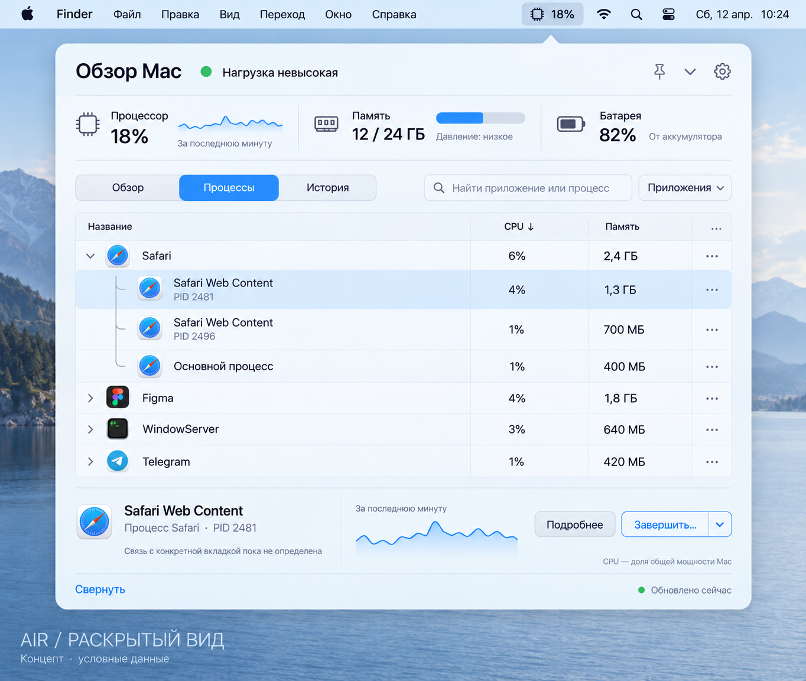
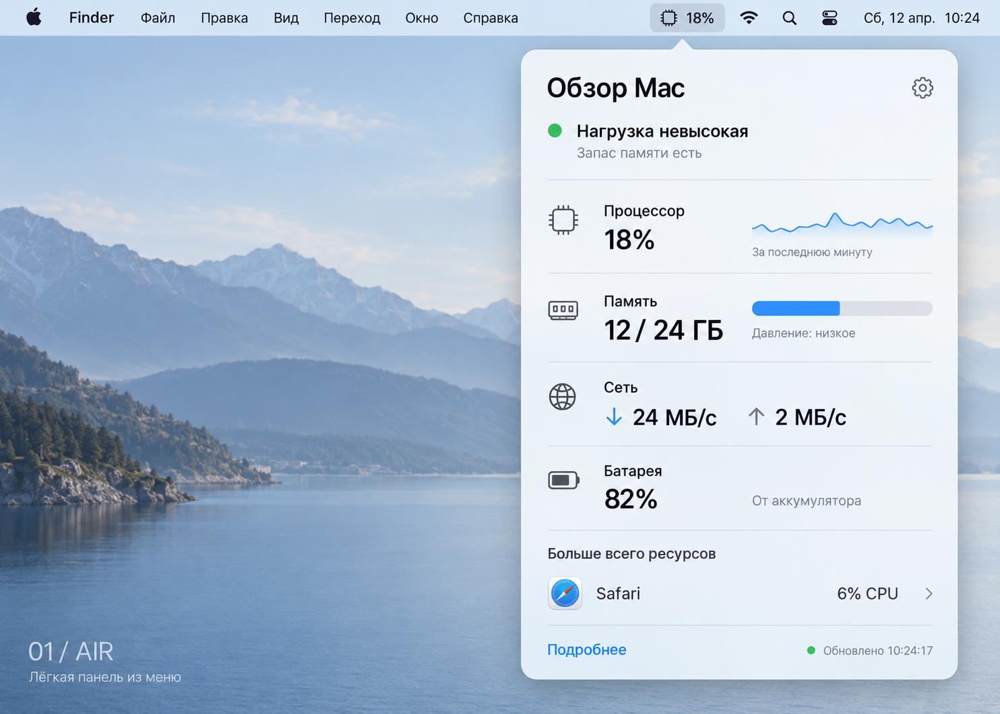
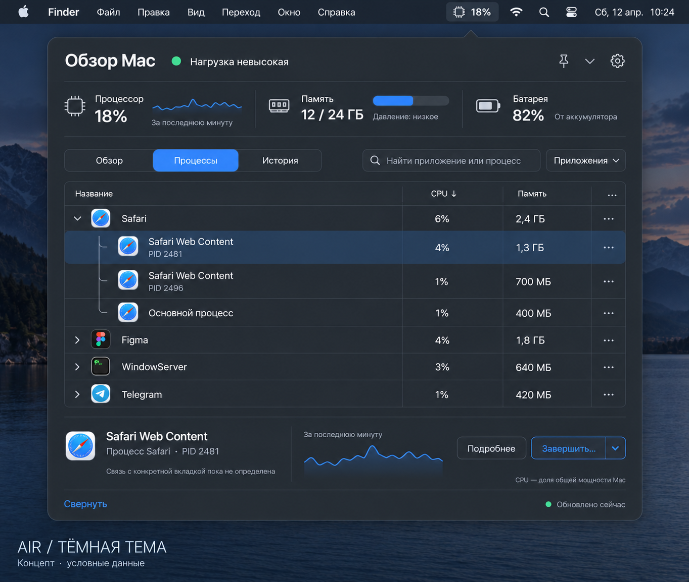

<div align="center">

# MacGlint

**Понятный взгляд на состояние Mac.**

Нативный монитор системы в строке меню macOS: CPU, память, процессы, история и личные уведомления.

[English](README.md) · [Макеты](docs/design/README.md) · [План разработки](docs/ROADMAP.md) · [Предложить идею](https://github.com/greenpandorik/macglint/issues/new/choose)

</div>

> **В первую очередь я делаю MacGlint для себя, с помощью ИИ.** Хочется удобный, современный монитор системы, которым приятно пользоваться каждый день. ИИ помогает прорабатывать дизайн, писать документацию и разрабатывать проект. Публикую всё открыто — возможно, кому-то ещё это окажется полезно.

> **Уже есть рабочая предварительная версия 0.2.0.** Приложение собирается и запускается локально. Публичного релиза с подписью и нотариализацией Apple пока нет. Изображения ниже — исходные ИИ-макеты с условными данными, а не скриншоты текущей сборки.

## Сборка и установка

Нужны **macOS 14+**, инструменты Xcode со Swift 5.9+ и Git. Проверено на Apple Silicon, macOS 26 и Xcode 26.4. Интерфейс пока на русском.

```sh
git clone https://github.com/greenpandorik/macglint.git
cd macglint
./scripts/build-app.sh
open build/MacGlint.app
```

Команда `./scripts/make-dmg.sh` создаёт в `build/` DMG для архитектуры вашего Mac: приложение можно перетащить в «Программы».

Это **локальная сборка с ad-hoc подписью**, без нотариализации Apple. Для обычного скачивания другими пользователями ещё нужен подписанный публичный выпуск. Не отключайте Gatekeeper для установки скачанных сборок. Homebrew и обновления внутри приложения — следующие этапы. [Подробнее об установке](docs/INSTALLATION.md).

## Идея

Клик по значку в строке меню открывает мини-панель. Кнопка **«Открыть полное окно»** ведёт в отдельное окно с процессами, историей и настройками. Его можно менять в размере и закрывать: мониторинг продолжится. Шестерёнка мини-панели сразу открывает настройки.

Основной сценарий: **обзор → приложение → процесс → действие**.

<picture>
  <source media="(prefers-color-scheme: dark)" srcset="docs/design/air-expanded-dark.png">
  <source media="(prefers-color-scheme: light)" srcset="docs/design/air-expanded-light.png">
  
</picture>

*На ранних макетах сохранилось рабочее название **Air**. Теперь проект называется **MacGlint**. Макеты на русском; предварительная версия приложения тоже на русском.*

## Что уже работает

| Возможность | Для чего |
|---|---|
| **Компактный обзор** | CPU, память, сеть и батарея; выбор постоянно видимых показателей в строке меню. |
| **Подробные процессы** | Поиск, сортировка, раскрытие приложений и график выбранного процесса. |
| **Управление процессами** | Обычное завершение и отдельное подтверждение принудительного завершения доступного процесса. |
| **Две темы** | Светлая, тёмная и переключение вслед за macOS. |
| **История нагрузки** | Посмотреть, что происходило во время замедления, с отметками алертов. |
| **Личные правила** | Пороги и длительность превышения для всего Mac или приложения, нехватки памяти и места на диске. |
| **Уведомления без спама** | Игнорирование коротких скачков, пауза, исключения и подавление повторов. |
| **Закреплённое окно** | Наблюдать за нагрузкой, пока работаешь в других приложениях. |

История хранится до 24 часов; график выбранного процесса — до двух минут текущего запуска. Автоматического завершения процессов нет. Исключения отключают правила выбранного приложения, но общие правила Mac продолжают работать.

## Макеты

<details>
<summary><strong>Компактный обзор</strong></summary>



</details>

<details>
<summary><strong>Раскрытый вид — светлая тема</strong></summary>


</details>

<details>
<summary><strong>Раскрытый вид — тёмная тема</strong></summary>



</details>

## Что со вкладками Safari

Safari — мой основной браузер. Хочется видеть, какая именно вкладка расходует ресурсы, но **точную привязку CPU и памяти к вкладкам ещё нужно проверить**.

Доступные процессы Safari и WebKit уже отображаются. Названия сайтов не будут подставляться к процессам по догадке. В [заметке об исследовании](docs/research/safari.md) описано, что известно и что предстоит проверить.

## Разработка и данные

Основа — **Swift, SwiftUI, AppKit и небольшие сборщики на C**. Сторонних библиотек нет. CPU показан как доля мощности всего Mac от 0 до 100%; память процессов — физический footprint. Сеть измеряется по 64-битным счётчикам физических интерфейсов `en*`, без повторного учёта VPN-туннелей.

Настройки и история хранятся на Mac. Списки процессов и история не отправляются в ИИ или на сервер. Разрешение на системные уведомления запрашивается только по кнопке; без него события остаются в локальной истории.

`swift test` проверяет расчёты, алерты, хранение и защиту завершения процессов. Тесты завершают только специально созданный дочерний процесс. [Разработка и ограничения](docs/DEVELOPMENT.md).

- [Спецификация](docs/superpowers/specs/2026-10-14-air-design.md)
- [План развития](docs/ROADMAP.md)
- [Установка](docs/INSTALLATION.md)
- [Архив макетов](docs/design/README.md)
- [Исследование Safari](docs/research/safari.md)
- [Участие в проекте](CONTRIBUTING.md)

Предложения и ошибки: [GitHub Issues](https://github.com/greenpandorik/macglint/issues). Это личный проект без обещанного графика выпусков.

Создано [Михаилом Волковым](https://github.com/greenpandorik) с помощью ИИ.
